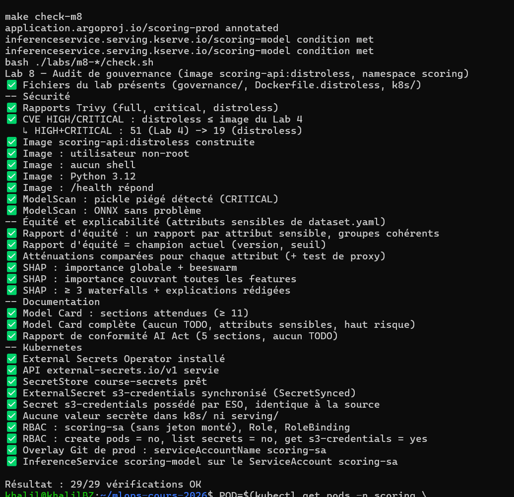
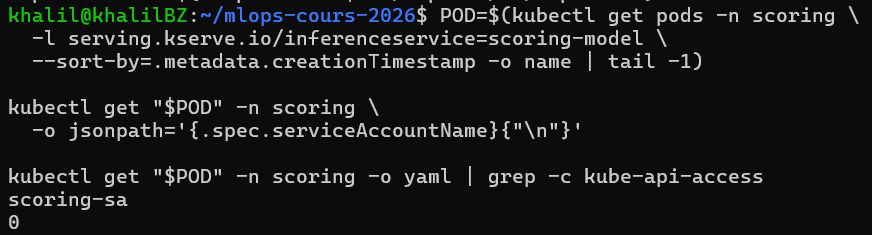

# Model Card — scoring-model v19

Dataset : german-credit · Date : 2026-11-21
Statut : prototype pédagogique ; validation technique du Lab 8 : 29/29.
Équipe : Khalil Ben Zahra et binôme du dépôt.

## 1. Détails du modèle

- Nom : `scoring-model`, version **19**, alias `champion` au moment de l'audit.
- Run MLflow : `f2d47c40fcfd4fe98b66a149ed010410`.
- Pipeline : ColumnTransformer puis LogisticRegression.
- Paramètres de l'estimateur : `{"C": 0.1, "class_weight": "balanced", "dual": false, "fit_intercept": true, "intercept_scaling": 1, "l1_ratio": 0.0, "max_iter": 1000, "n_jobs": null, "penalty": "deprecated", "random_state": 42, "solver": "lbfgs", "tol": 0.0001, "verbose": 0, "warm_start": false}`.
- Sortie : probabilité de la classe défavorable `bad`.
- Refus si P(bad) ≥ **0.3182**, seuil choisi selon le coût métier.
- Registry : skops ; serving : ONNX, opset 17.
- SHA-256 ONNX : `4b7517525ab6398be391bb58404f8584bdb49502cace1ca070d43b99ddaa222e`.
- Image durcie auditée : `localhost:5001/scoring-api:1.0.0-distroless`.
- Traçabilité : Git, DVC, MLflow et rapports de cet audit.
- Équipe : Khalil Ben Zahra et binôme du dépôt ; contact via les auteurs du dépôt GitHub.
- Licence des données déclarée dans dataset.yaml : CC BY 4.0.
  La licence du code et du modèle doit être vérifiée dans le dépôt avant redistribution.

## 2. Usage prévu

Prototype pédagogique d'audit d'un modèle de risque de crédit, destiné aux étudiants
et à leur enseignant. Le namespace nommé production reste un environnement de cours.

Usages interdits dans le cadre de ce prototype :
- décider automatiquement d'un refus de crédit réel ;
- fixer un taux, un plafond ou des conditions commerciales réelles ;
- cibler défavorablement un groupe selon ses attributs sensibles ;
- appliquer le modèle à une autre population, époque ou pays sans nouvelle validation ;
- réutiliser le modèle pour l'assurance, l'emploi ou le logement.

## 3. Facteurs

Les attributs sensibles déclarés sont `age` (<25 / >=25), `personal_status`
et `foreign_worker`. Ils sont tous utilisés directement par le champion.
`personal_status` combine sexe et situation personnelle ; `foreign_worker`
ne constitue pas une mesure exhaustive de la nationalité ou de l'origine.

Retirer un attribut ne supprime pas ses proxies : les AUC de prédiction du groupe
depuis les autres variables sont 0,77 pour age, 0,71 pour personal_status
et 0,78 pour foreign_worker. Les variables révélatrices et les résultats détaillés
figurent dans [la comparaison](../reports/fairness_mitigated.txt).

Le contexte économique, la population, les modalités catégorielles et la qualité
des données peuvent modifier les résultats.

## 4. Métriques

### Performance globale

Évaluation sur **200 demandes**, seuil **0.3182**.
La classe positive est le risque : sélectionner signifie refuser.

| Mesure | Valeur |
|---|---:|
| ROC AUC | 0.8026 |
| Rappel | 86.67% |
| Précision | 44.44% |
| F1 | 0.5876 |
| Accuracy | 63.50% |
| Taux de refus | 58.50% |
| Coût métier | 105 |
| Coût si tout accepter | 300 |
| Coût si tout refuser | 140 |

Matrice de confusion : `[[75, 65], [8, 52]]`.
Lignes = classe réelle [bon, mauvais] ; colonnes = décision [accord, refus].
Coût : faux négatif ×5 + faux positif ×1.

### Performance par groupe

#### age

| Groupe | n | Défaut réel | Refus [IC 95 %] | TPR | FPR | Coût/demande |
|---|---:|---:|---|---:|---:|---:|
| <25 | 39 | 49% | 69% [55% ; 83%] | 89% | 50% | 0.51 |
| >=25 | 161 | 25% | 56% [47% ; 63%] | 85% | 46% | 0.53 |

#### personal_status

| Groupe | n | Défaut réel | Refus [IC 95 %] | TPR | FPR | Coût/demande |
|---|---:|---:|---|---:|---:|---:|
| female div/dep/mar | 61 | 33% | 70% [57% ; 80%] | 95% | 59% | 0.48 |
| male div/sep | 9 | 33% | 67% [33% ; 100%] | 100% | 50% | 0.33 |
| male mar/wid | 12 | 25% | 58% [25% ; 88%] | 67% | 56% | 0.83 |
| male single | 118 | 29% | 52% [42% ; 60%] | 82% | 39% | 0.53 |

#### foreign_worker

| Groupe | n | Défaut réel | Refus [IC 95 %] | TPR | FPR | Coût/demande |
|---|---:|---:|---|---:|---:|---:|
| no | 6 | 17% | 33% [0% ; 84%] | 100% | 20% | 0.17 |
| yes | 194 | 30% | 59% [51% ; 66%] | 86% | 47% | 0.54 |

### Indicateurs d'équité

| Attribut | Écart parité des refus | Ratio d'acceptation | Écart equalized odds |
|---|---:|---:|---:|
| age | 0,133 | 0,698 | 0,042 |
| personal_status | 0,188 | 0,611 | 0,333 |
| foreign_worker | 0,259 | 0,611 | 0,274 |

Le ratio de 0,8 est un indicateur de dépistage, pas une preuve de conformité
juridique ni un verdict automatique de discrimination.

## 5. Données d'évaluation

Jeu de test de 200 demandes, issu d'une séparation stratifiée 80/20,
random_state=42. Les effectifs figurent en section 4.
Les groupes de 6, 9 et 12 personnes sont particulièrement fragiles.
Les intervalles bootstrap ne corrigent ni le manque de représentativité
ni les biais historiques. Les atténuations comparées sur ce test nécessiteraient
un jeu indépendant avant toute sélection pour un usage réel.

## 6. Données d'entraînement

German Credit : 1 000 demandes, dont 800 pour l'entraînement, 20 variables.
Selon dataset.yaml, les observations concernent une banque allemande en 1973–1975,
avec publication UCI en 1994. Ces données anciennes ne représentent pas
les demandeurs de crédit actuels.

Source : Hofmann, H. (1994), Statlog (German Credit Data), UCI,
https://doi.org/10.24432/C5NC77 ; licence déclarée CC BY 4.0.
Contrat, colonnes, groupes et matrice de coûts : dataset.yaml.
Les attributs sensibles sont des catégories historiques simplifiées,
sans garantie qu'ils décrivent correctement les identités actuelles.

## 7. Analyse quantitative

Les disparités sont mesurées au seuil effectivement servi.
Retirer age dégrade ici le coût et les indicateurs d'équité.
Pour age, ExponentiatedGradient améliore le ratio d'acceptation à 0,83,
mais augmente le coût de 10,5 % et dégrade l'écart EO à 0,118.
ThresholdOptimizer optimise des seuils par groupe ; son objectif accuracy
peut fortement augmenter le coût métier. Les stratégies sont évaluées
séparément pour chaque attribut et ne démontrent pas une équité simultanée.

**Décision : aucune atténuation déployée, champion 19 conservé.**
Les expériences locales ne constituent pas une validation pour un crédit réel.

### Comparaison chiffrée

```text
Champion v19 · seuil 0.318 · coût de référence 105

=== Attribut sensible : age ===
                             coût    Δcoût refus DP diff ratio acc. EO diff attribut en prod
champion                      105    +0.0%   58%   0.133       0.70   0.042              oui
sans_attribut                 111    +5.7%   64%   0.154       0.60   0.094              non
threshold_optimizer_accuracy  248  +136.2%    7%   0.040       0.96   0.037              oui
threshold_optimizer_cout      120   +14.3%   60%   0.013       0.97   0.117              oui
exponentiated_gradient        116   +10.5%   64%   0.065       0.83   0.118              non
Proxy : le groupe se devine sans la colonne avec une AUC de 0.77
        variables les plus révélatrices : housing (0.69), personal_status (0.67), employment (0.63)

=== Attribut sensible : personal_status ===
                             coût   Δcoût refus DP diff ratio acc. EO diff attribut en prod
champion                      105   +0.0%   58%   0.188       0.61   0.333              oui
sans_attribut                 119  +13.3%   68%   0.172       0.49   0.389              non
threshold_optimizer_accuracy  154  +46.7%   26%   0.199       0.74   0.529              oui
threshold_optimizer_cout      100   -4.8%   65%   0.194       0.53   0.333              oui
exponentiated_gradient        118  +12.4%   65%   0.140       0.64   0.333              non
Proxy : le groupe se devine sans la colonne avec une AUC de 0.71
        variables les plus révélatrices : age (0.64), housing (0.61), employment (0.61)

=== Attribut sensible : foreign_worker ===
                             coût   Δcoût refus DP diff ratio acc. EO diff attribut en prod
champion                      105   +0.0%   58%   0.259       0.61   0.274              oui
sans_attribut                 107   +1.9%   62%   0.129       0.74   0.119              non
threshold_optimizer_accuracy  178  +69.5%   20%   0.034       0.96   0.559              oui
threshold_optimizer_cout      103   -1.9%   57%   0.077       0.85   0.136              oui
exponentiated_gradient        110   +4.8%   64%   0.144       0.71   0.141              non
Proxy : le groupe se devine sans la colonne avec une AUC de 0.78
        variables les plus révélatrices : duration (0.77), property_magnitude (0.67), purpose (0.67)

-> reports/fairness_mitigated.json

```

### Explicabilité SHAP

Les contributions sont exprimées en log-odds et ne sont pas des effets causaux.
checking_status est la variable la plus importante ; personal_status est sixième.
Les trois attributs sensibles contribuent aux prédictions.

- Demande 230 : probabilité 0,884, refus.
- Demande 160 : probabilité 0,032, accord.
- Demande 807 : accord proche du seuil ; changer uniquement certains attributs
  sensibles fait basculer la décision. La probabilité affichée est arrondie.

[Importance globale](../reports/shap_summary_bar.png),
[beeswarm](../reports/shap_beeswarm.png),
[explications locales](../reports/explanations_local.md).

## 8. Considérations éthiques

Les données historiques peuvent reproduire des inégalités d'accès au crédit.
Les attributs sensibles et leurs proxies exposent à des traitements différenciés.
Un faux positif prive un bon payeur de crédit ; un faux négatif expose la banque
et potentiellement le demandeur à un crédit inadapté.
La matrice de coûts pédagogique ne mesure pas tous ces préjudices.
Les résultats ne démontrent ni une discrimination juridiquement établie,
ni l'absence de discrimination.

## 9. Mises en garde et recommandations

Aucune utilisation pour décider de vrais crédits n'est validée.
Avant un usage réel : données récentes et représentatives, test indépendant,
évaluation des petits groupes et des intersections, validation humaine,
procédure de contestation, analyse des impacts et suivi des dérives.
Les atténuations peuvent être randomisées ou nécessiter l'attribut sensible
à l'inférence : ces propriétés doivent être examinées avant tout déploiement.

## 10. Sécurité de la chaîne

Image durcie testée localement : Python 3.12.16, utilisateur 65532:65532,
absence de shell ; health, prédiction et métriques fonctionnels.

Trivy 0.75.0 : baseline 51 occurrences HIGH, image durcie 19 occurrences HIGH,
aucune CRITICAL. Un écart reste non expliqué pour setuptools :
Trivy annonce 70.3.0, les métadonnées inspectées indiquent 84.2.1.
Aucun faux positif confirmé ni absence de vulnérabilité revendiquée.

ModelScan 0.8.8 : pickle normal code 0, pickle piégé code 1
(posix.system, CRITICAL), ONNX ignoré code 3.
skops liste numpy.dtype comme type hors de sa liste de confiance.
Le pickle piégé ne doit jamais être chargé ni commité.

Le téléchargement MLflow depuis WSL fonctionne avec
MLFLOW_ENABLE_PROXY_MULTIPART_DOWNLOAD=false.

RBAC créé : create pods=no, list secrets=no, lecture du Secret S3 nommé=yes,
lecture inter-namespace=no. Le patch Git a été fusionné par la PR #17 et appliqué par Argo CD.
Le pod de production utilise scoring-sa ; aucun volume kube-api-access
n'a été trouvé. Validation officielle : 29/29.

External Secrets Operator installé ; SecretStore Valid et ExternalSecret
SecretSynced. Clés identiques à la source, propriétaire ExternalSecret et
recréation automatique après suppression vérifiés sans afficher les valeurs.

## 11. Cadre réglementaire

Prototype pédagogique sans décision sur de vrais demandeurs.
Un usage réel européen d'évaluation de solvabilité relève du haut risque
(annexe III, 5 b). Calendrier officiel consulté : 2 décembre 2027 pour
les règles haut risque de l'annexe III. Le RGPD reste applicable selon
son champ, notamment les articles 22 et 35.
La conformité pour un usage bancaire réel n'est pas établie.

Voir le [rapport AI Act et RGPD](../reports/compliance-ai-act.md)
pour les sources officielles, les preuves et les écarts.

### Preuves de validation finale




