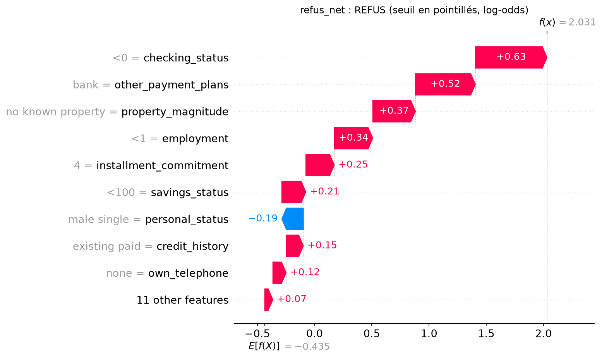
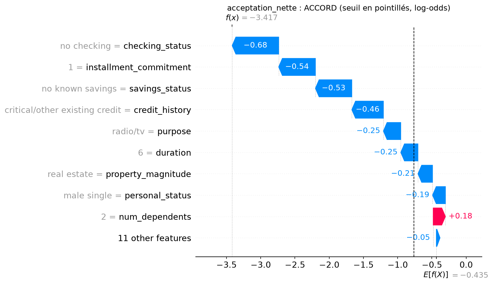
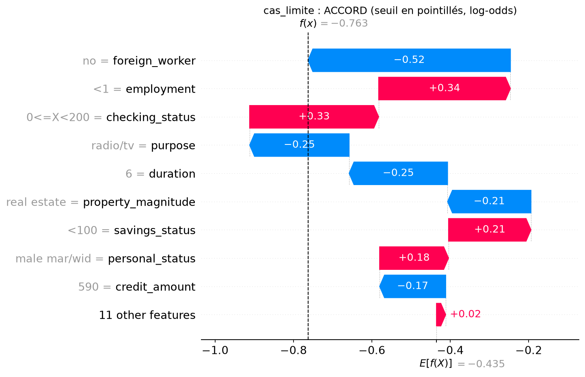

# Explications individuelles — german-credit, modèle v19

Seuil de refus : P(bad) >= 0.318.

## refus_net — demande 230 : P(bad) = 0.884 → REFUS

Principaux motifs défavorables :

- checking_status = <0 (+0.63)
- other_payment_plans = bank (+0.52)
- property_magnitude = no known property (+0.37)

Principaux éléments favorables :

- personal_status = male single (-0.19) [attribut sensible]
- housing = for free (-0.04)
- existing_credits = 1 (-0.04)

Test contrefactuel (un seul attribut sensible modifié) : aucun.

## acceptation_nette — demande 160 : P(bad) = 0.032 → ACCORD

Principaux motifs défavorables :

- num_dependents = 2 (+0.18)
- own_telephone = none (+0.12)
- existing_credits = 2 (+0.07)

Principaux éléments favorables :

- checking_status = no checking (-0.68)
- installment_commitment = 1 (-0.54)
- savings_status = no known savings (-0.53)

Test contrefactuel (un seul attribut sensible modifié) : aucun.

## cas_limite — demande 807 : P(bad) = 0.318 → ACCORD

Principaux motifs défavorables :

- employment = <1 (+0.34)
- checking_status = 0<=X<200 (+0.33)
- savings_status = <100 (+0.21)

Principaux éléments favorables :

- foreign_worker = no (-0.52) [attribut sensible]
- purpose = radio/tv (-0.25)
- duration = 6 (-0.25)

Test contrefactuel (un seul attribut sensible modifié) : age -> <25, personal_status -> female div/dep/mar, personal_status -> male div/sep, foreign_worker -> yes.

