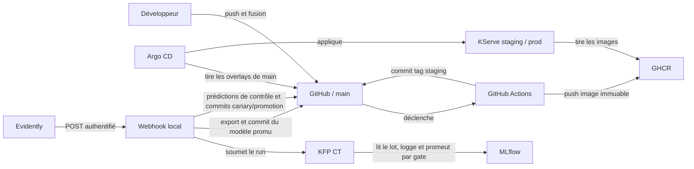
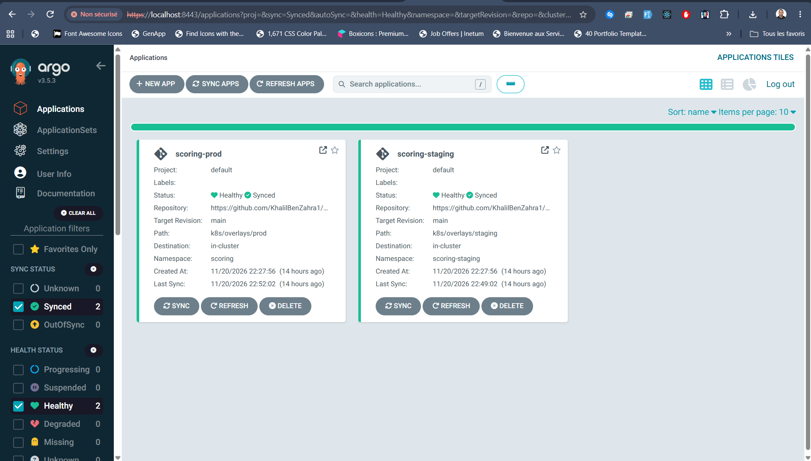
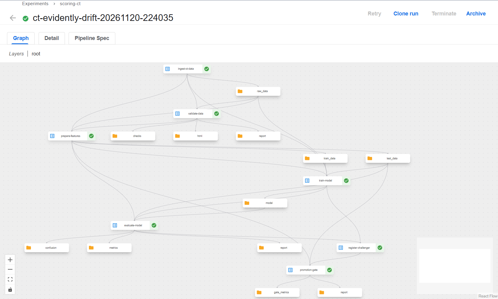
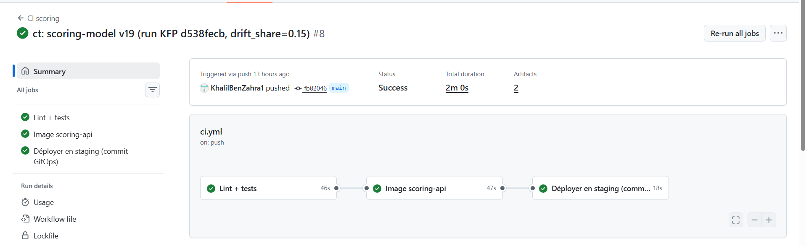
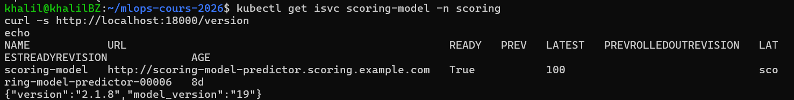
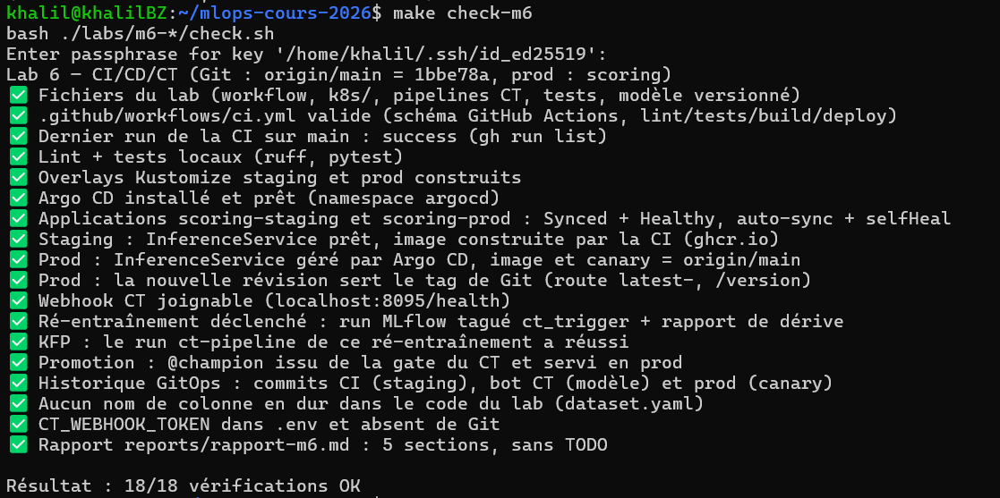

# Rapport — Lab 6 : CI/CD/CT de bout en bout

Pilote : Khalil Ben Zahra (`KhalilBenZahra1`), option B et revue croisée avec `oumaimagorrab`. Dépôt : `KhalilBenZahra1/mlops-cours-2026`. Dataset : `german-credit`. Mesures du **20 novembre 2026** sur Ubuntu 24.04 WSL2 / Docker Desktop, cluster kind à trois nœuds Ready. Les PR **#7 → #8 → #9 → #10** ont été approuvées, retargetées vers `main` puis fusionnées dans cet ordre ; commits staging conservés. Le présent bilan final est livré dans une nouvelle PR de documentation, à relire avant fusion.

État confirmé : production **`ghcr.io/khalilbenzahra1/mlops-cours-2026/scoring-api:2.1.8`**, modèle **19**, seuil **0.3182**, révision **`scoring-model-predictor-00006`**, trafic **100 %**. `@champion` et `@challenger` sont à 19, l'ancien champion 18 est conservé. Le champion 18 de la première séance n'était pas alors servi : il a d'abord été publié et déployé manuellement avant ce nouveau cycle automatique.

## 1. Architecture

Le code et l'architecture du professeur sont conservés. La CI teste, construit, réalise le smoke test puis publie dans GHCR ; elle n'accède pas au cluster. Argo CD **v3.5.3** lit `main` avec auto-sync, prune et selfHeal. Les deux Applications sont **Synced/Healthy**. KFP utilise **8082**, MLflow **5000**, Argo UI **8443**, le webhook **8095** et Kourier **30080** ; les applications sur 8080/8081 sont préservées. Le package GHCR est accessible anonymement et un nœud kind a réellement téléchargé l'image, sans `kind load`.

La production du Lab 5 a été adoptée avec le même spec et le même modèle 17. SelfHeal démontré : patch manuel de 100 à 50 %, retour automatique à **100 % en 2.01 s**, spec restauré. Les révisions historiques et les versions MLflow sont conservées.

## 2. Temps du cycle

Scénario automatique réussi : variables numériques continues configurées multipliées par **1,5**, lot étiqueté de 1 000 lignes, **15 %** de variables en dérive. Le webhook a été lancé avec `CT_AUTO_RELEASE=1`, `CT_AUTO_PROMOTE=1`, `CT_LOCAL_CI=0`. Après `detect`, aucune commande de publication, de refresh Argo ou de promotion n'a été exécutée manuellement pendant ce cycle.

Horodatages **UTC**, issus des API KFP/GitHub, des commits et d'un observateur local :

| Étape | Début UTC | Fin UTC | Durée |
|---|---|---|---|
| Détection et soumission KFP | 2026-11-20T21:40:28.303551+00:00 | 2026-11-20T21:40:35+00:00 | 6.696 s |
| Pipeline CT, ingest → gate | 2026-11-20T21:40:35+00:00 | 2026-11-20T21:44:15+00:00 | 220.000 s |
| Commit modèle → image publiée | 2026-11-20T21:44:27+00:00 | 2026-11-20T21:46:04+00:00 | 97.000 s |
| Image publiée → staging observé | 2026-11-20T21:46:04+00:00 | 2026-11-20T21:49:18.161769+00:00 | 194.162 s |
| Canary prêt à 10 % → promotion observée à 100 % | 2026-11-20T21:50:14.454503+00:00 | 2026-11-20T21:52:05.265964+00:00 | 110.811 s |
| **Cycle complet** | 2026-11-20T21:40:28.303551+00:00 | 2026-11-20T21:52:05.265964+00:00 | 696.962 s |

Le cycle complet vaut **11.62 min**. La fin de publication est celle de l'étape CI `Publier l'image testée` ; les états servis sont les premières observations de `/version` et du trafic Kubernetes. L'observateur interroge environ toutes les trois secondes, en plus du temps des requêtes : ces valeurs sont des latences observées et non une précision sub-seconde garantie. Il maintient staging actif pendant la mesure. Les délais d'attente du bot entre KFP, Git et CI font partie du cycle complet ; les sous-intervalles ne sont pas présentés comme une somme exhaustive.

Une seule exécution réussie ne mesure pas une distribution de performances. La construction/publication CI et la réconciliation Argo contribuent au temps total ; les caches et le réseau influencent les résultats. Le segment publication → staging observé vaut 194.162 s : la configuration Argo de 60 s et 10 s de gigue n'est pas une garantie du délai complet, qui inclut commit GitOps, détection du changement, téléchargement et démarrage. La part de chaque cause n'a pas été isolée. La promotion manuelle précédente a demandé un refresh Argo normal : cette intervention n'est pas incluse dans le cycle automatique mesuré ici.

## 3. Gates et décisions

Run KFP **`d538fecb-e59e-4d95-a5f0-76ebbd3a5037`**, `ct-evidently-drift-20261120-224035` : **SUCCEEDED**, sept tâches réussies (`ingest-ct-data`, `validate-data`, `prepare-features`, `train-model`, `evaluate-model`, `register-challenger`, `promotion-gate`). Run MLflow d'entraînement **`f2d47c40fcfd4fe98b66a149ed010410`** ; rapport et lot : `runs:/c03767f36e094618adbbd54f9e262183/drift_report.html` et `runs:/c03767f36e094618adbbd54f9e262183/batch/current.csv`. Les tags `kfp_run_id`, `ct_trigger`, `ct_drift_share`, `previous_champion` et `promotion=passed` relient les étapes.

### Gate de promotion : version 19 PROMUE

| Règle | Résultat |
|---|---|
| roc_auc >= 0.7 | OK |
| business_cost <= 108 (champion v18) | OK |

| Modèle | roc_auc | coût métier |
|---|---|---|
| challenger v19 | 0.8094 | 108 |
| champion v18 | 0.8094 | 108 |

Chaque modèle est évalué au seuil de son propre run sur les **mêmes données récentes** ; les règles du contrat ne sont pas modifiées. Le nouveau numéro de version atteste une nouvelle exécution et un nouvel enregistrement ; il ne démontre pas à lui seul un gain prédictif. Le lot ×1,5 est celui du scénario déjà utilisé pour le champion 18.

La phase manuelle de l'étape 8 a publié le modèle 18 dans **2.1.7** : sur 200 appels au canary 10 %, **181 anciennes réponses / 19 nouvelles**, sans erreur ; après promotion, **200/200** réponses 2.1.7. Le bot a ensuite effectué son analyse naïve du nouveau canary (50 prédictions sur la route `latest-`), puis poussé le commit à 100 %. Son historique porte `released=true` ; trafic, `/version` et prédictions ont été revérifiés sur le cluster. Aucun rollback n'a été nécessaire.

Preuve Git du cycle automatique :

| Étape | Commit | Horodatage | Sujet |
|---|---|---|---|
| model | `fb82046` | 2026-11-20T21:44:27+00:00 | `ct: scoring-model v19 (run KFP d538fecb, drift_share=0.15)` |
| staging | `3e8000c` | 2026-11-20T21:46:28+00:00 | `gitops(staging): ghcr.io/khalilbenzahra1/mlops-cours-2026/scoring-api:2.1.8 [fb82046]` |
| canary | `937485f` | 2026-11-20T21:49:24+00:00 | `gitops(prod): canary 10% 2.1.8` |
| promotion | `1bbe78a` | 2026-11-20T21:50:17+00:00 | `gitops(prod): promote 100% 2.1.8` |

[CI automatique réussie](https://github.com/KhalilBenZahra1/mlops-cours-2026/actions/runs/44822990660). Image résolue par Knative : **`ghcr.io/khalilbenzahra1/mlops-cours-2026/scoring-api@sha256:1c0d2a48bb6b6a1b2c013bd7a94f85c6f42cab1138fb906f3862248cdf07b0f2`**. SHA-256 ONNX : **`4b7517525ab6398be391bb58404f8584bdb49502cace1ca070d43b99ddaa222e`**. Le seuil exporté **0.3182** vient du run, sans constante ajoutée pour cette version.

**Écart au scénario ×2 de l'étape 9.3 :** le run `5ac6dafd-f7b7-48e8-abc2-17c82f87705c` a réellement échoué à `validate-data` (2 contrôles sur 67). Les bornes GX figées sont 116 pour la durée et 131 pour l'âge ; ×2 produit **14/1 000** et **18/1 000** valeurs hors contrat, au-delà de la tolérance de **1 %**. Préparation et entraînement n'ont pas démarré, aucune version n'a été promue ni publiée. Le scénario ×1,5, lui aussi prévu par le guide, ne dépasse pas ces bornes tout en produisant le drift de 15 %. Il a servi au cycle positif, **sans régénérer GX, modifier les seuils ou changer le code du pipeline**. La réussite du cycle ×2 exact n'est donc pas revendiquée.

Validation réelle sur `main` après le cycle : **`Résultat : 18/18 vérifications OK`**, code retour **0**, aucun SKIP ; contrôle officiel inchangé. Référence précédente : 11/18 avant les fusions, sept validations alors bloquées. Non-régression après le cycle : **M0 19/19, M1 18/18, M5 14/14**, lint réussi ; les **57 tests** sont exécutés par le contrôle M6. Équivalence ONNX/scikit-learn revérifiée sur 200 lignes après le nouvel export (voir preuves). Airflow reste arrêté comme demandé ; le contrôle M2 complet n'a pas été rejoué pour ne pas présenter ses services arrêtés comme disponibles.

## 4. Points d'attention

Le webhook écoute uniquement sur `127.0.0.1` ; le jeton reste dans `.env` ignoré et n'est affiché ni commité. Tests réels précédents : **401 sans jeton**, **202 authentifié**. Les accès Git du bot restent ceux du pilote, obtenus via l'authentification `gh` existante, sans modifier clés ou remotes. Le code des quatre PR a été revu avant fusion ; la publication manuelle du modèle de l'étape 8, puis les commits automatiques de publication et de déploiement prévus par le lab arrivent sur `main` sans PR, conformément à l'autorisation du pilote.

Les trois états sont distincts : alias Registry, artifacts ONNX dans Git et image réellement servie. Leur concordance finale a été vérifiée ; elle ne découle pas du déplacement d'un alias. Pour un retour arrière, il faut piloter le trafic par Git et vérifier l'alias précédent ; une modification manuelle durable serait annulée par selfHeal. Aucun volume, bucket, modèle ou historique supprimé, aucun nettoyage global.

## 5. Différences avec la prod

La gate GX a montré son utilité en bloquant le scénario ×2. Le lot étiqueté reste simulé depuis le dataset du cours : il prouve l'orchestration, pas la qualité d'un monitoring sur une vraie population récente. La référence de drift reste l'ancien `train.csv` du guide ; elle n'est pas actualisée automatiquement après promotion, ce qui peut provoquer une nouvelle alerte sur un lot identique. L'état et le cooldown du webhook sont en mémoire ; ce TP ne démontre pas la reprise durable après panne.

L'analyse naïve de 50 prédictions vérifie la disponibilité et les probabilités, sans comparer les distributions d'erreurs ou de latences des deux révisions. Les étapes suivantes du cours traiteront ce sujet. En production, discuter de labels retardés, validation humaine, secrets managés, identité limitée du bot, PR de release, environnements séparés, audit et reprise. Ces pistes ne sont pas implémentées dans ce lab.

## 6. Captures d'écran et preuves

Les fichiers [preuves-cycle.json](m6/preuves-cycle.json), [validation.txt](m6/validation.txt) et [gate.md](m6/gate.md) conservent les mesures, identifiants et sorties authentiques. Les cinq captures PNG ci-dessous ont été réalisées manuellement par le pilote le **21 novembre 2026**, après remise en marche de l'environnement existant. Elles complètent les preuves du cycle du 20 novembre ; elles ne représentent pas une nouvelle exécution de ce cycle. La tentative de capture automatisée précédente n'avait pas abouti ; les PNG fournis par le pilote sont désormais intégrés au rendu.

Les originaux sont conservés sans retouche. Les fichiers ont été ouverts et examinés : états et textes lisibles, aucun secret visible, aucune métadonnée textuelle PNG embarquée. Cliquer sur une image permet de l'ouvrir à sa taille d'origine, notamment pour lire les libellés du graphe KFP.

### 6.1 Argo CD : staging et production synchronisés

*Figure 1 — Argo CD v3.5.3 : `scoring-prod` et `scoring-staging` sont toutes deux Healthy et Synced, suivent `main` et les overlays de leurs namespaces respectifs.*

### 6.2 Kubeflow : run de ré-entraînement continu du Lab 6

*Figure 2 — Expérience `scoring-ct`, run `ct-evidently-drift-20261120-224035`, identifiant `d538fecb-e59e-4d95-a5f0-76ebbd3a5037` : les sept tâches sont réussies, jusqu'à `register-challenger` et `promotion-gate`. Le nom affiché a été recoupé avec l'API KFP et les preuves JSON ; il s'agit bien du CT du Lab 6, et non du pipeline à huit composants du Lab 3. L'UUID n'est pas visible dans ce cadrage.*

### 6.3 GitHub Actions : publication et commit GitOps

*Figure 3 — Workflow `CI scoring`, run nº 8, commit `fb82046` (`ct: scoring-model v19`, run KFP `d538fecb`) : succès des trois jobs lint/tests, image et déploiement staging par commit GitOps. La durée totale affichée par Actions, 2 min, concerne ce workflow ; elle ne remplace pas les 97 s du segment commit modèle → fin de publication, ni les 696,962 s du cycle complet.*

### 6.4 Production : modèle effectivement servi

*Figure 4 — `scoring/scoring-model` est Ready, la révision `scoring-model-predictor-00006` reçoit 100 % du trafic et `/version` répond `2.1.8` / modèle `19`. L'appel sur `localhost:18000` passe par le port-forward local de cette révision existante ; la commande Kubernetes fournit la preuve distincte du trafic de production.*

### 6.5 Validation officielle du lab

*Figure 5 — Exécution réelle de `make check-m6` dans Ubuntu, sur le dépôt du pilote : les 18 contrôles sont réussis, sans SKIP, avec le message final `Résultat : 18/18 vérifications OK`. L'invite SSH affiche seulement le chemin de la clé : aucune passphrase ni aucun contenu de clé n'est visible.*

La capture du canary transitoire et une capture séparée de MLflow ne font pas partie de ces cinq fichiers. Le routage 181/19, la promotion 200/200, les aliases et les tags du modèle restent documentés par les preuves existantes et le rapport de gate ; aucune capture manquante n'est fabriquée. Le run ×2 rejeté reste consultable dans KFP comme preuve de protection, et le cycle positif ×1,5 ainsi que ses mesures restent inchangés dans les sections précédentes.
